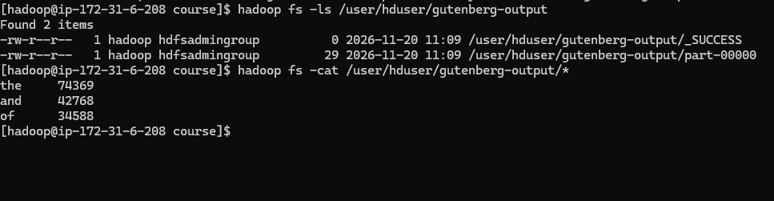

# big-data-ex2
## Exercise 1

**Q1. How many files are there?**
There are **6** output partition files (`part-00000` through `part-00005`), plus 1 `_SUCCESS` status file (7 items in total). *(In the first run with default settings, there were 3 partition files + 1 `_SUCCESS` file).*

**Q2. Did the number of mappers change?**
**No.** It remained **9** in both runs, because the number of mappers is determined by the number of input splits, not by the `-numReduceTasks` parameter.

**Q3. Did the number of reducers change?**
**Yes.** It increased from **3** (default) to **6**, because we explicitly passed `-numReduceTasks 6`.

**Q4. Did the number of output files change? Why?**
**Yes**, it changed from 3 to 6 partition files. In Hadoop MapReduce, each reducer writes its results to its own dedicated output file (`part-00000`, `part-00001`, etc.), so 6 reducers produce 6 output files.

**Q5. What does the value of 'Merged Map outputs' represent, and how is it calculated?**
It represents the total number of intermediate map output partitions fetched and merged by all reducers during the shuffle-and-merge phase.
It is calculated as: `Number of Map Tasks × Number of Reduce Tasks`.
- Run 1 (default): `9 × 3 = 27`
- Run 2 (`-numReduceTasks 6`): `9 × 6 = 54`

## Exercise 2

**Q1. Is your change in the mapper or in the reducer?**
The change is in the **mapper**. Words must be normalized (lowercased and stripped of trailing commas and dots) before the shuffle-and-sort phase so that variations like `"The"`, `"the,"`, and `"the."` map to the exact same key (`"the"`) and are grouped together by the reducer.

**Q2. Code**
See [`mapper_ex2.py`](./mapper_ex2.py) in this repository.

## Exercise 3

**Q1. Is your change in the mapper or in the reducer?**
The change is in the **reducer**. Finding the top 3 most frequent words requires knowing the total aggregated count of every word first, which is only available in the reducer. We also run the job with `-numReduceTasks 1` so that a single reducer computes the global top 3 instead of each partition returning its own top 3.

**Q2. Code**
See [`reducer_ex3.py`](./reducer_ex3.py) (run together with [`mapper_ex2.py`](./mapper_ex2.py)) in this repository.

**Q3. Output**

